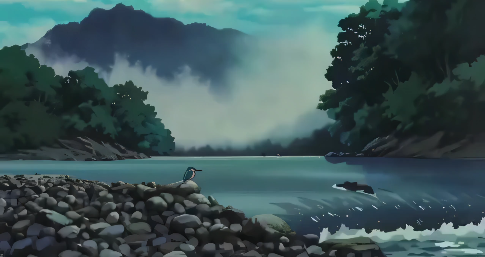
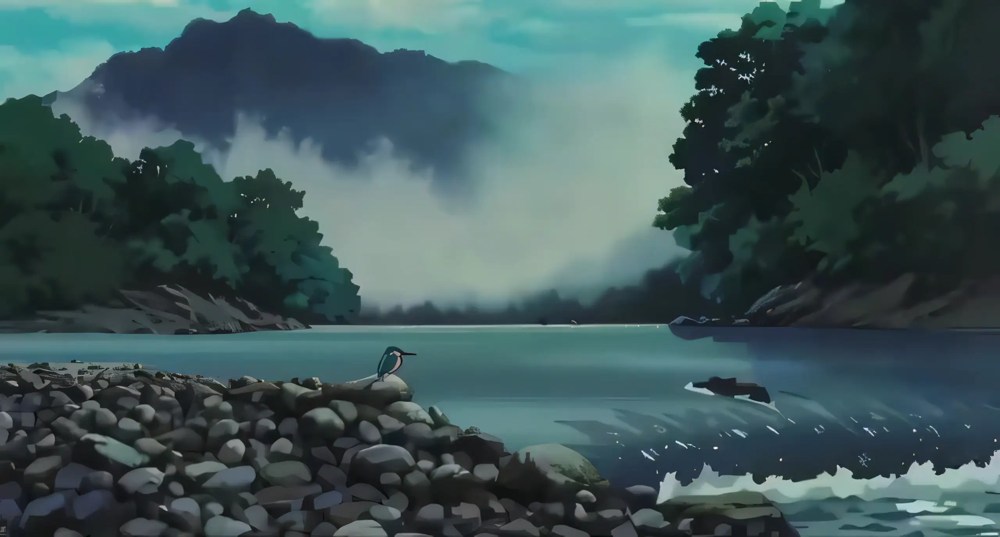

# AI Video Upscaler & WebP Generator

A containerized (Docker), GPU-accelerated environment to upscale low resolution videos up to 4x using AI (Upscayl/NCNN) and convert them into lightweight, high quality animated WebP backgrounds. This project was born out of a personal desire to create custom, crisp WebP animated backgrounds for my Homarr dashboard.

### Before vs After

<p align="center">
  
  
</p>

## Features

* **100% Dockerized:** Keeps your host system clean.
* **GPU Acceleration:** Fully utilizes Vulkan pass through for Nvidia/AMD GPUs.
* **CLI Automation:** No GUI, simpler and less chances of something crashing. Just drop your video and run a script.
* **Output Efficient:** Generates optimized mp4 & WebP files fully optimized.

## Folder Structure

```text
/workspace
├── docs/images/        # Screenshots for this README
├── input/              # Drop your raw videos here
├── output/             # Enhanced videos and WebP files will appear here
├── resources/          # Upscayl binaries and AI Models
└── scripts/            # Automation scripts
```

## Installation

1. Clone this repository.
2. Build and run the Docker container (requires Docker with GPU passthrough configured):
   ```bash
   ./run_docker.sh
   ```

## Usage

Make sure you are inside the Docker container terminal `/workspace#`.

### 1. Upscale a Video (4x)

Place your low res video (e.g., `video.mp4`) into the `input/` folder and run:

```bash
./scripts/upscale.sh input/video.mp4
```

The script will extract frames, process them through the AI, reassemble the video and save the result to `output/video_4x.mp4`.

### 2. Convert to Animated WebP

Take your newly enhanced video and convert it into a lightweight WebP:

```bash
./scripts/generate_webp.sh output/video_4x.mp4
```

The optimized animated background will be saved to `output/video_4x.webp`.

### Final Result (Animated WebP)

<p align="center">
  
</p>

The results are obviously less appealing than having the original high resolution video, since the AI won't replicate the work artists do, but can give an easy and fast result for less demanding use cases.

## Acknowledgments & Credits

This project was built upon the foundations laid by these amazing open-source projects:

* [**Upscayl**](https://github.com/upscayl/upscayl)**:** The core AI image upscaling engine used to process the video frames.
* [**UpscaylVideo (by troygeiger)**](https://github.com/troygeiger/UpscaylVideo/tree/main)**:** Served as the primary base and inspiration for conceptualizing this containerized video upscaling workflow.